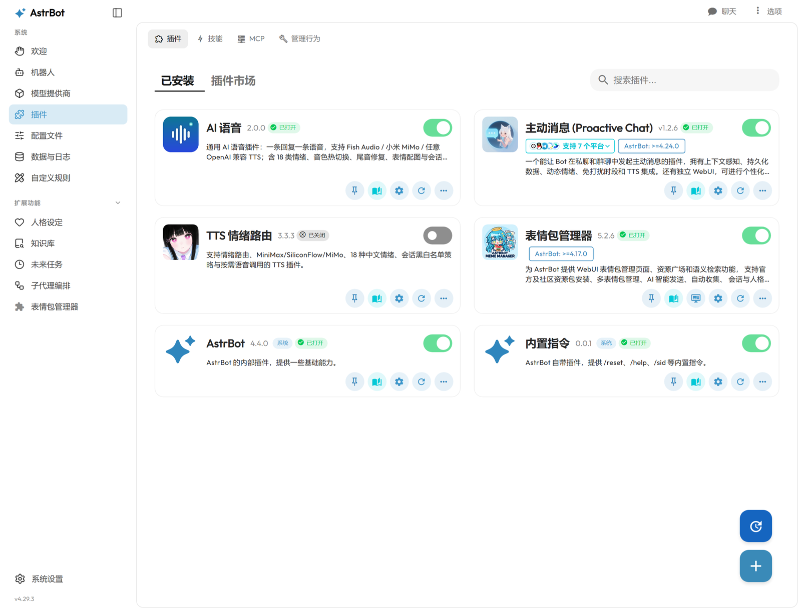
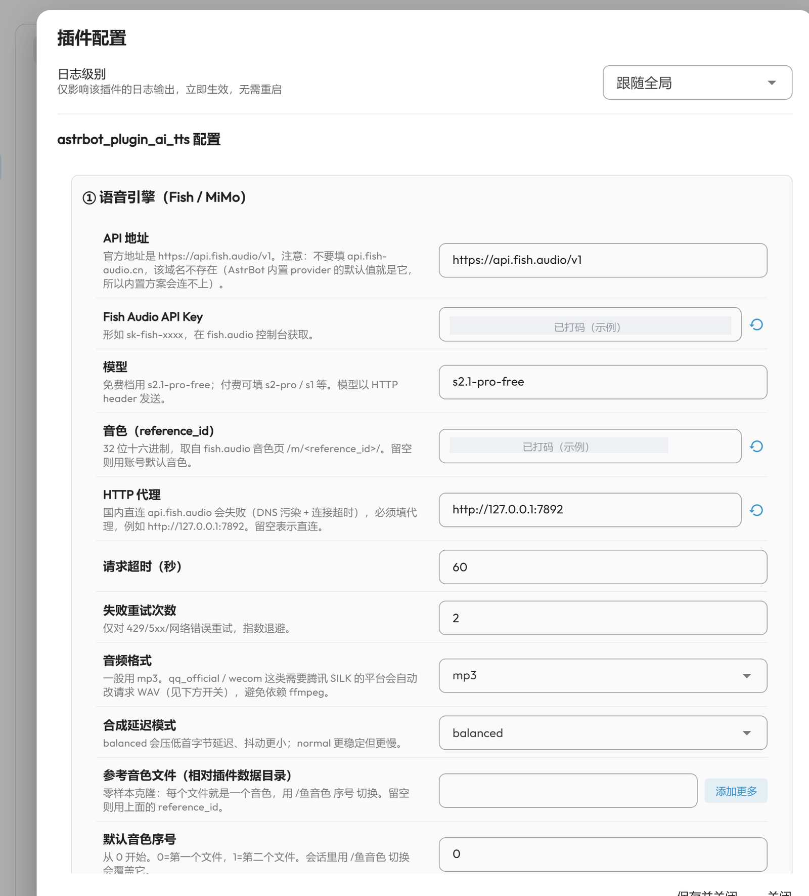
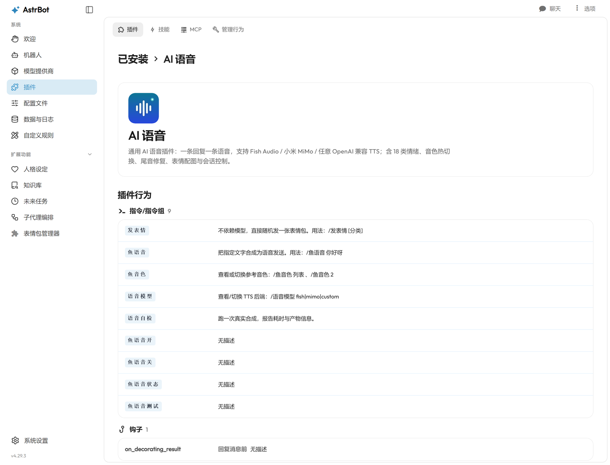

# AI 语音 · AstrBot 插件

把 AstrBot 的文字回复变成语音，**一条回复只发一条语音**。
支持 Fish Audio、小米 MiMo，以及**任何 OpenAI 兼容的 TTS 接口**（自己填地址和 Key）。

[](LICENSE)
[](https://github.com/FluxCore42/astrbot_plugin_ai_tts/releases)
[](https://github.com/AstrBotDevs/AstrBot)

---

## 目录

- [界面预览](#界面预览)
- [它解决什么问题](#它解决什么问题)
- [快速开始（3 步）](#快速开始3-步)
- [安装](#安装)
- [选一个后端](#选一个后端)
- [配置说明](#配置说明)
- [指令](#指令)
- [工作原理](#工作原理)
- [常见问题](#常见问题)
- [兼容性](#兼容性)
- [开发](#开发)
- [License](#license)

## 界面预览

插件列表（图标 + 名称 + 状态）：



配置面板按 ①~⑧ 分组，每一项都带说明：



插件详情页会列出所有指令与钩子：



## 它解决什么问题

AstrBot 自带的 TTS 常见三件糟心事，本插件都处理了：

| 症状 | 原因 | 本插件的处理 |
|---|---|---|
| 一条回复变成「文字 + 语音」两条气泡 | 消息链里同时留了 Plain 和 Record | 整条链换成 Record，只发一条 |
| 语音最后半句被切掉、结尾「咔」一声 | Fish 返回的 WAV 头长度字段不可靠，且音频在高振幅处硬切 | 重写 WAV 头 + 40ms 淡出 + 250ms 尾部静音 |
| 同一个音色听起来有时像换了个人 | 零样本克隆每次重新猜说话人 | 推荐用训练音色 id；零样本时提示会漂 |

## 快速开始（3 步）

1. **装插件**（见下方[安装](#安装)）
2. **选后端并填 Key**：面板 → 插件 → **AI 语音** → 分组 ① → `provider` 选 `fish`，填 `api_key`
3. **验证**：QQ 里发 `/语音自检`，看到「自检通过 + 耗时」就成功了

之后正常聊天，按 `probability`（默认 50%）随机把回复转成语音。

## 安装

### 方式 A：面板上传（最简单）

1. 下载 [Release 里的 zip](https://github.com/FluxCore42/astrbot_plugin_ai_tts/releases)
2. 面板 → 插件 → 安装 → 上传 zip
3. 重启 AstrBot 或点「重载插件」

### 方式 B：从 GitHub 安装

面板 → 插件 → 安装 → **从 GitHub**，填：

```
https://github.com/FluxCore42/astrbot_plugin_ai_tts
```

### 方式 C：命令行

```bash
cd AstrBot/data/plugins
git clone https://github.com/FluxCore42/astrbot_plugin_ai_tts.git
```

依赖只有 `aiohttp`（AstrBot 自带，无需额外安装）。

## 选一个后端

插件用 `provider` 决定把文字发给谁。三选一，其余分组可以不动。

### ① Fish Audio（音质好，可训练音色）

| 字段 | 填什么 | 示例 |
|---|---|---|
| `provider` | `fish` | `fish` |
| `base_url` | Fish 接口地址 | `https://api.fish.audio/v1` |
| `api_key` | Fish 控制台的 Key | `sk-fish-...` |
| `model` | 免费档或付费档 | `s2.1-pro-free` |
| `reference_id` | **训练音色 id**（推荐） | `e8b5f2ea...` |
| `reference_files` | 零样本参考音频（会漂，不推荐） | `[]` |
| `proxy` | 走代理时填 | `http://127.0.0.1:7892` |

> **为什么推荐训练音色**：同一段参考音频做零样本克隆，三次合成音高能差 60–120Hz，
> 听感像换人；训练音色只有 4–10Hz。想要同一个声音，就用训练音色 id。

### ② 小米 MiMo

| 字段 | 填什么 | 示例 |
|---|---|---|
| `provider` | `mimo` | `mimo` |
| `mimo_key` | MiMo Key | `sk-...` |
| `mimo_base_url` | 接口地址 | `https://api.xiaomimimo.com/v1` |
| `mimo_model` | 模型 | `mimo-v2.5-tts` |
| `mimo_voice` | 音色名，或本地音频路径（克隆） | `冰糖` / `voices/my.mp3` |

MiMo 的情绪走「（开心）」这类前缀，插件会自动把识别到的情绪转成前缀。

### ③ 任意 OpenAI 兼容接口（custom）

只要对方是 `POST {base_url}/audio/speech` 这种格式就能用：

| 字段 | 填什么 | 示例 |
|---|---|---|
| `provider` | `custom` | `custom` |
| `custom_base_url` | 到 `/v1` 为止 | `https://api.siliconflow.cn/v1` |
| `custom_api_key` | 服务商 Key | `sk-...` |
| `custom_model` | 模型名 | `tts-1` |
| `custom_voice` | 音色名（留空则不传） | `alloy` |
| `custom_auth_header` | 鉴权头 | `bearer` / `api-key` / `x-api-key` |
| `custom_json_field` | 返回 JSON+base64 时填字段路径 | `data.audio` |
| `custom_extra_json` | 额外请求体 | `{"speed":0.95}` |

实际发出的请求：

```json
{
  "model": "tts-1",
  "input": "要念的文字",
  "voice": "alloy",
  "response_format": "wav"
}
```

## 配置说明

面板里按 ①~⑧ 分组，下面是每组的默认值与作用。

### ① 语音引擎

| 键 | 默认 | 说明 |
|---|---|---|
| `provider` | `fish` | `fish` / `mimo` / `custom` |
| `base_url` | `https://api.fish.audio/v1` | Fish 接口 |
| `api_key` | 空 | Fish Key |
| `model` | `s2.1-pro-free` | Fish 模型 |
| `format` | `mp3` | 请求格式；QQ 官方会强制 wav |
| `latency` | `balanced` | Fish 延迟模式，`balanced` 抖动更小 |
| `timeout` | `60` | 单次请求超时（秒） |
| `max_retries` | `2` | 失败重试次数 |
| `proxy` | 空 | HTTP 代理，如 `http://127.0.0.1:7892` |
| `reference_id` | 空 | 训练音色 id |
| `reference_files` | `[]` | 零样本参考音频路径（相对插件数据目录） |
| `reference_index` | `0` | 多参考音频时的默认序号 |

### ② 通用引擎（custom）

见上文第三节，默认 `custom_model = tts-1`，其余为空。

### ③ 发语音策略

| 键 | 默认 | 说明 |
|---|---|---|
| `auto_speak` | `true` | 总开关 |
| `probability` | `0.5` | 每条回复转语音的概率 |
| `send_text` | `false` | 语音是否附带同款文字（开了会两条气泡） |
| `min_chars` | `4` | 太短的回复不念 |
| `max_chars` | `40` | 语音单段字数上限，超过改发文字 |
| `max_segments` | `1` | 最多几段语音 |
| `cooldown_seconds` | `2` | 同会话语音冷却 |
| `max_concurrency` | `2` | 同时合成数 |
| `speed` | `0.93` | 固定语速，1.0 为原速 |
| `tail_padding_ms` | `250` | 结尾静音（毫秒），0 表示不加（仍会修 WAV 头） |
| `qq_official_wav` | `true` | QQ 官方机器人请求 WAV（SILK 转换需要） |
| `platforms` | `["aiocqhttp","qq_official","qq_official_webhook"]` | 生效平台 |
| `skip_if_record_exists` | `true` | 链里已有语音就跳过，避免和其它 TTS 插件打架 |

### ④ 情绪与语气

| 键 | 默认 | 说明 |
|---|---|---|
| `auto_detect` | `true` | 识别 18 类情绪 |
| `prosody` | `true` | 语速随情绪双向变化 |
| `strength` | `0.6` | 情绪幅度，0~1。日常 0.5~0.7 |
| `fish_emotion` | `true` | 使用 Fish 的 emotion 字段 |
| `text_style` | `true` | 按情绪补标点（最稳的情绪手段） |
| `tag_prefix` | `false` | 额外加 `[开心]` 标签（部分模型会念出来） |
| `default_tag` | 空 | 固定情绪标签 |
| `extra_tags` | `[]` | 追加标签白名单 |
| `mimo_emotion` | `true` | MiMo 是否加「（开心）」前缀 |

### ⑤ 回复清理

| 键 | 默认 | 说明 |
|---|---|---|
| `enabled` | `true` | 总开关 |
| `max_chars` | `80` | 回复字数上限，超出按句截断 |
| `strip_actions` | `true` | 删除 `*动作*`、`（旁白）`、Markdown |

### ⑥ 表情配图（可选）

| 键 | 默认 | 说明 |
|---|---|---|
| `enabled` | `true` | 是否配图 |
| `probability` | `20` | 随机配图概率（%） |
| `max_size_mb` | `4` | 图片体积上限 |
| `skip_when_voice` | `true` | 发语音时不配图（QQ 会把图和语音拆两条） |

> 需要安装 `meme_manager` 插件并放好图库，否则自动跳过。

### ⑦ 缓存与性能

| 键 | 默认 | 说明 |
|---|---|---|
| `enabled` | `true` | 磁盘缓存开关 |
| `max_files` | `300` | 缓存文件上限 |
| `ttl_days` | `7` | 缓存保留天数 |

### ⑧ 会话控制

| 键 | 默认 | 说明 |
|---|---|---|
| `default_enabled` | `true` | 新会话默认开启语音 |
| `whitelist` | `[]` | 强制开启的会话 UMO |
| `blacklist` | `[]` | 强制关闭的会话 UMO |

## 指令

### `/鱼语音` 系列（语音控制）

| 指令 | 作用 |
|---|---|
| `/鱼语音 <文字>` | 把指定文字转成语音 |
| `/鱼语音开` / `/鱼语音关` | 本会话自动语音开关 |
| `/鱼语音状态` | 查看模型、音色、缓存与最近错误 |
| `/鱼语音测试` | 立刻合成一句（管理员） |
| `/鱼音色 列表` | 列出参考音频 |
| `/鱼音色 2` | 切到第 2 个参考音频（按会话记） |

### `/语音` 系列（后端与自检）

| 指令 | 作用 |
|---|---|
| `/语音模型` | 查看可用后端与当前选择 |
| `/语音模型 fish` / `mimo` / `custom` | 切换本会话后端 |
| `/语音自检` | 真实合成一次，报告耗时与产物大小 |

### 表情

| 指令 | 作用 |
|---|---|
| `/发表情` | 随机发一张 |
| `/发表情 开心` | 指定分类 |

## 工作原理

```
LLM 回复
  ↓ on_decorating_result（优先级 -2000，晚于其它 TTS 插件）
① 清理：去动作 / 去 Markdown / 半角转全角 / 去 emoji
② 情绪：18 类关键词分类 → prosody 或 MiMo 前缀 + 标点语气
③ 合成：按 provider 调对应客户端（带磁盘缓存、并发限流、重试）
④ 修复：WAV 头重写 + 40ms 淡出 + tail_padding 静音
⑤ 发送：整条消息链替换为 Record，一条回复一条语音
```

几个设计取舍：

- **优先级 -2000**：让其它 TTS 插件先跑，如果它们已经放了 Record，本插件直接跳过
- **缓存 key 含音色与情绪**：换音色不会命中旧音频
- **全角标点**：Fish 对中文逗号的停顿更敏感，半角会被当成普通字符，听起来像在赶
- **不用 numpy**：音频处理只用标准库 `wave` + `array`，减少依赖

## 常见问题

**Q：完全没有语音，日志里也没报错？**

按顺序查：`auto_speak` 是否开 → `provider` 是否填对 → `probability` 是否太低 →
回复是否都超过 `max_chars`（超了会改发文字）→ 会话是否被 `/鱼语音关` 过。

**Q：报 402 / Insufficient API credit？**

免费模型额度用完了，或你选了付费模型但账户没余额。Fish 付费档（`s2-pro`、`s1`）
需要充值；免费档是 `s2.1-pro-free`。

**Q：语音结尾被切掉或有「咔」声？**

已内置修复（重写 WAV 头 + 淡出 + 静音）。如果嫌结尾停顿长，把
`tail_padding_ms` 从 250 调到 150；设 0 则不加静音（但仍修头）。

**Q：同一句话两次听起来不是同一个人？**

用的是零样本克隆（`reference_files`）。换训练音色 id（`reference_id`），
或把 `fish_emotion` / `prosody` 关掉减少抖动。

**Q：语音里有「（歪头）」这种旁白？**

插件会删括号与星号动作。若仍出现，说明是正文叙述（没括号），
在人格提示词里加一句「禁止动作描写」。

**Q：角色坚持「我发不出声音」？**

模型把之前失败的对话当成事实了。发 `/reset` 清一次上下文。

**Q：一条消息回了好几条？**

AstrBot 的「分段回复」开着，会按句号拆条。关掉：
`platform_settings.segmented_reply.enable = false`。

**Q：代理怎么填？**

`proxy` 填 `http://127.0.0.1:端口`，需与你的代理软件端口一致（常见 7890 / 7892）。
填了之后所有请求都走代理；本地接口不要填。

## 兼容性

| 项目 | 说明 |
|---|---|
| AstrBot | 4.x（`on_decorating_result` 钩子与 `Record` 组件） |
| 平台 | `aiocqhttp`、`qq_official`、`qq_official_webhook` |
| QQ 官方 | 需要 WAV，插件会自动请求 wav 并由适配器转 SILK，无需 ffmpeg |
| Python | 3.10+（用到 `X | None` 语法） |

## 开发

```bash
# 跑离线测试（不联网）
python -m pytest tests/test_text.py tests/test_plugin_hook.py -q
```

目录：

```
main.py              钩子、指令、发送逻辑
emotion.py           18 类情绪分类与 prosody 映射
reply_style.py       回复清理（去动作 / 全角标点 / 截断）
providers/
  fish.py            Fish Audio 客户端（WAV 修复、缓存、重试）
  mimo.py            小米 MiMo 客户端
  openai.py          OpenAI 兼容客户端
  text.py            文本切分、情绪标签解析
tests/               离线测试
```

新增一个后端只需实现：

```python
async def synthesize(text, *, audio_format=None, emotion_tag="") -> Path
```

然后在 `main.py` 的 `_synth_text` 里加一个分支。

## License

[MIT](LICENSE) © 2026 大肥鱼